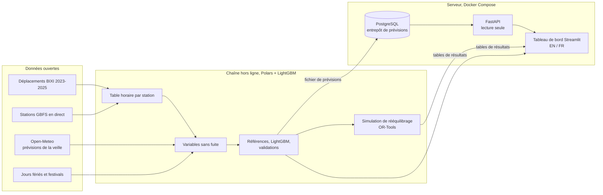

# Plateforme de prévision de la demande et de rééquilibrage BIXI

[](http://103.99.176.180/bixi/?lang=fr)


[](https://github.com/omarfaruqe/bixi-platform/actions/workflows/ci.yml)

🇬🇧 [English version](README.md)

Un projet de science des données bilingue (English / Français) sur le réseau de vélos en libre-service
BIXI de Montréal. Il répond à la question : **combien de départs et d’arrivées faut-il prévoir à
chaque station, et où faut-il redistribuer les vélos?**

**Démo en ligne :** <http://103.99.176.180/bixi/?lang=fr> (anglais : <http://103.99.176.180/bixi/>),
un tableau de bord Streamlit et un service de prévision FastAPI, servis avec Docker derrière Caddy.

> **État d’avancement :** version 1.0.0, les dix étapes de construction sont terminées. Voir
> [CHANGELOG.md](CHANGELOG.md) (en anglais).

| Vue d’ensemble | Prévisions de la veille |
|---|---|
|  |  |
| **Simulation du rééquilibrage** | **Analyse des déplacements (en français)** |
|  |  |

## Principaux résultats
- **Les prévisions battent les références.** Sur une période de validation de six semaines
  (du 1er octobre au 14 novembre 2025, jamais vue à l’entraînement), LightGBM avec une fonction
  de perte de Poisson a une erreur absolue moyenne de 1,92 départ par station-heure : **33 % de
  moins** que « la même heure la semaine précédente » et 27 % de moins que la meilleure référence
  simple.
- **Les prévisions météo comptent, la météo parfaite à peine plus.** Les prévisions météo de la
  veille réduisent l’erreur de 7 à 8 % au total et d’environ un tiers les heures de pluie;
  connaître la météo réelle n’ajouterait que 0 à 3 %.
- **Des intervalles fiables.** Les intervalles de prédiction à 80 % (modèles de quantiles et
  calibration conforme) contiennent la valeur réelle 80 % du temps.
- **Le rééquilibrage fondé sur les prévisions est rentable.** Sur 45 jours, des tournées de camions
  optimisées avec OR-Tools à partir des prévisions de la veille réduisent de **20 %** les
  station-heures sans vélo ou sans point d’ancrage libre (2 camions, stations à moitié pleines au
  départ), contre 13 % pour une règle empirique, avec 15 % moins de kilomètres; c’est deux tiers de
  ce qu’une connaissance parfaite de la journée permettrait.
- **Le navettage crée le déséquilibre.** En semaine, le matin, le Plateau perd des vélos et le
  centre-ville se remplit : Square-Victoria gagne environ 125 vélos entre 7 h et 10 h, soit
  3,4 fois ses 37 points d’ancrage.

Détails : [docs/model_results.md](docs/model_results.md) et [docs/decisions.md](docs/decisions.md)
(en anglais).

## Portée
- Déplacements historiques de 2023 à 2025 (39 millions), restreints à 50 stations après
  vérification de la qualité et de la continuité des données
- Analyse horaire des départs et des arrivées, carte des stations
- Prévisions horaires émises la veille avec intervalles de prédiction à 80 %, à partir de la
  demande passée, du calendrier québécois, des événements et des prévisions météo archivées
  (aucune information future)
- Base de prévisions (PostgreSQL) et API en lecture seule (FastAPI)
- Simulation de rééquilibrage selon des hypothèses explicites sur l’inventaire initial de vélos et
  la capacité des stations

**Limite importante :** les déplacements observés ne correspondent pas à la demande réelle. Les
déplacements historiques seuls ne permettent pas d’établir les ruptures de stock ni la demande
non satisfaite; les résultats du rééquilibrage sont donc des estimations de scénarios.

## Architecture

Le travail lourd (8 Go de déplacements bruts, entraînement des modèles, optimisation des tournées)
se fait hors ligne. Le serveur ne reçoit que de petits fichiers de résultats : une série de
prévisions (environ 2 Mo) chargée dans PostgreSQL et les tables lues par le tableau de bord; il
n’a donc besoin ni de LightGBM ni d’OR-Tools. Le tableau de bord lit les prévisions uniquement par
l’API. La justification de chaque choix : [docs/decisions.md](docs/decisions.md) (en anglais).

## Démarrage rapide
```bash
python -m venv .venv && source .venv/bin/activate
make install        # pip install -e ".[app,data,ml,api,opt,dev]"   (macOS : brew install libomp)
make check          # analyse du code, formatage et tests
make app            # http://localhost:8501/?lang=fr
```
Le tableau de bord a besoin des données traitées. Pour tout reconstruire à partir des données
ouvertes brutes :
```bash
python -m bixi.download all                 # déplacements, stations, météo observée (environ 8 Go)
python -m bixi.download weather-forecast    # prévisions météo de la veille archivées
make data                                   # choix des stations, ingestion, variables
python -m bixi.models                       # références, validations, modèles finaux (~20 min)
python -m bixi.forecast export-holdout      # la série de prévisions servie par l’API
make rebalance                              # scénarios de rééquilibrage
make api                                    # http://localhost:8000/docs  (nécessite DATABASE_URL)
```
Rapports générés : [docs/model_results.md](docs/model_results.md) et
[docs/rebalancing_results.md](docs/rebalancing_results.md) (en anglais).

## Tests
`make check` exécute ruff et environ 120 tests (`make coverage` ajoute un rapport de couverture,
environ 80 % des lignes). Ils couvrent :
- **Règles de données :** fuseaux horaires et changement d’heure, limites de la saison, faux
  départs, longs déplacements, identité et choix des stations.
- **Fuite d’information :** chaque variable date d’au moins 24 heures, les décalages ne
  traversent jamais l’hiver et les variables de production ne contiennent ni météo observée ni
  cibles.
- **Modèles et métriques :** références, gain, intervalles conformes et refus d’exporter des
  prévisions sur la période d’entraînement.
- **Entrepôt et API :** publication, remplacement et activation des séries, jour du changement
  d’heure, erreurs. Ils tournent sur SQLite en local et sur PostgreSQL 16 en intégration continue.
- **Rééquilibrage :** simulation de l’inventaire, cibles, les deux planificateurs, capacité des
  camions et limites de temps.
- **Tableau de bord :** chaque page s’affiche en anglais et en français, l’application complète
  avec la navigation et le changement de langue, et les catalogues de traduction (mêmes clés,
  mêmes paramètres, aucune clé manquante).

L’intégration continue (GitHub Actions) construit aussi l’image de production et démarre toute la
pile Docker Compose avec un test de fumée.

## Déploiement
Un projet `docker compose` (`bixi`) de trois conteneurs : PostgreSQL, l’API et le tableau de bord,
liés à 127.0.0.1 et publiés sous `/bixi/` par le proxy inverse déjà présent sur le serveur. Il ne
partage rien avec les autres applications du serveur. Guide pas à pas, mises à jour et
dépannage : [deploy/README.md](deploy/README.md) (en anglais).

## Langues
L’anglais est la langue par défaut; le sélecteur de la barre latérale change la navigation, les
filtres, les libellés des graphiques, les infobulles, les explications et les messages d’erreur,
et `?lang=fr` permet de partager un lien en français. Les noms de stations restent dans leur forme
originale. Les nombres, pourcentages, dates et heures suivent la langue choisie (paramètres
régionaux canadiens : 1 234,5 et 17 h en français, 1,234.5 et 17:00 en anglais).

## Données et conventions
Déplacements : [données ouvertes de BIXI Montréal](https://bixi.com/fr/donnees-ouvertes/).
Météo : [Open-Meteo](https://open-meteo.com/) (réanalyse ERA5 et prévisions archivées). Liste des
stations : flux GBFS public de BIXI. Les données brutes ne sont pas redistribuées dans ce dépôt;
les commandes de téléchargement les récupèrent aux sources. Le code, les colonnes de la base de
données et les champs de l’API sont en anglais.

## Feuille de route
| Étape | Livrable | État |
|---|---|---|
| 1 | Structure du projet et squelette bilingue de l’application | Terminée |
| 2 | Téléchargement, inspection et validation des données BIXI | Terminée |
| 3 | Pipeline d’ingestion reproductible | Terminée |
| 4 | Exploration des déplacements et carte des stations | Terminée |
| 5 | Météo et tables horaires de modélisation | Terminée |
| 6 | Modèles de référence et évaluation des prévisions | Terminée |
| 7 | Stockage et diffusion des prévisions avec FastAPI | Terminée |
| 8 | Simulation de redistribution | Terminée |
| 9 | Tableau de bord bilingue complet | Terminée |
| 10 | Documentation, tests, déploiement | Terminée |

Suites possibles : prévoir la saison 2026 dès que BIXI publiera ses déplacements
(`python -m bixi.forecast export-model`), calibrer les intervalles par niveau d’achalandage et
ajouter des stations hors du centre.
