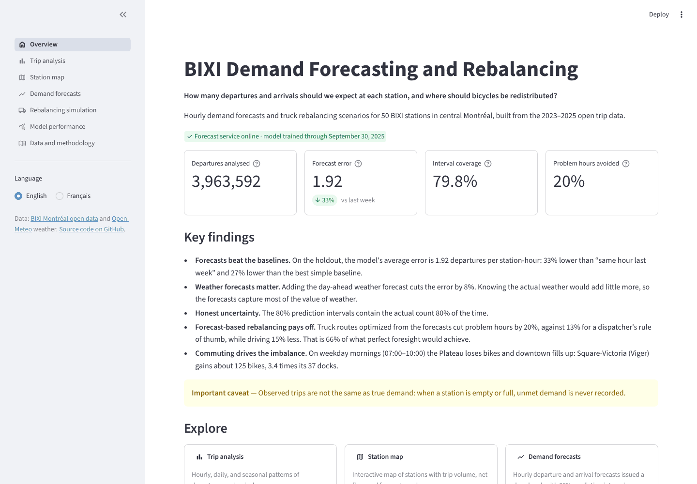
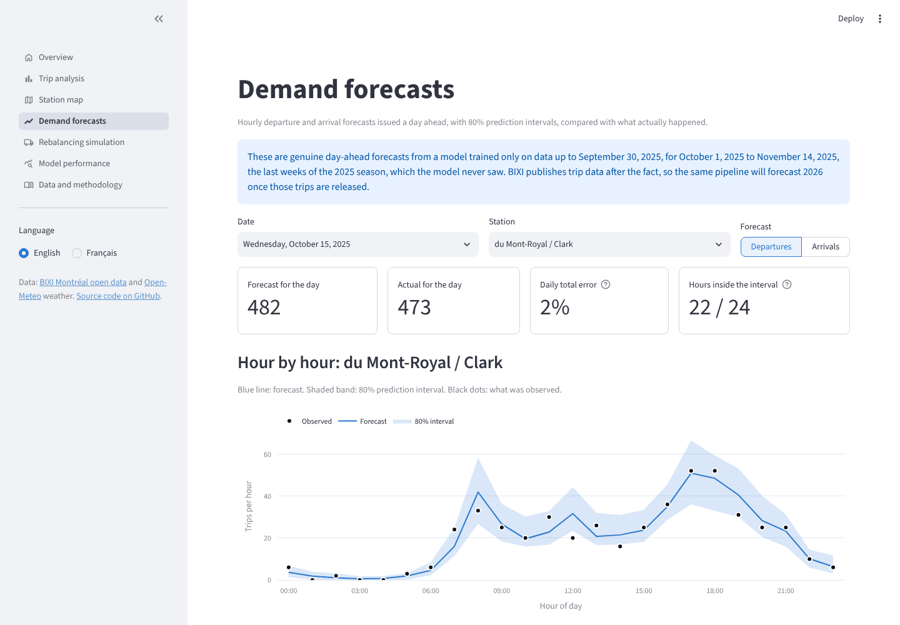
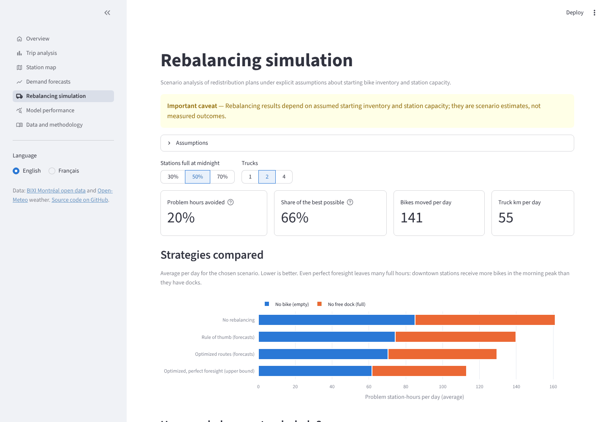
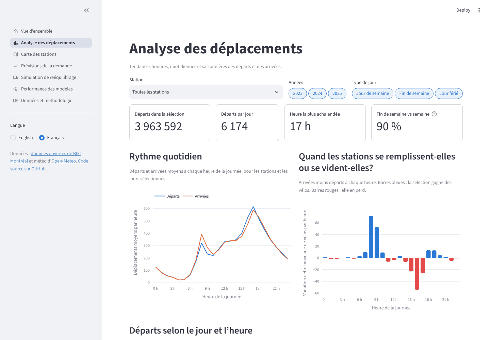
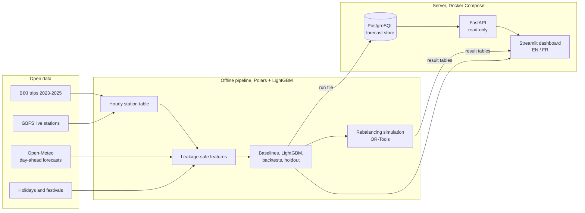

# BIXI Demand Forecasting and Rebalancing Platform

[](http://103.99.176.180/bixi/)


[](https://github.com/omarfaruqe/bixi-platform/actions/workflows/ci.yml)

🇫🇷 [Version française](README.fr.md)

A bilingual (English / Français) data science project for Montréal's BIXI bike-share system. It
answers: **how many departures and arrivals should we expect at each station, and where should
bicycles be redistributed?**

**Live demo:** <http://103.99.176.180/bixi/> (French: <http://103.99.176.180/bixi/?lang=fr>),
a Streamlit dashboard and a FastAPI forecast service, served with Docker behind Caddy.

> **Status:** version 1.0.0, all ten build steps complete. See [CHANGELOG.md](CHANGELOG.md).

| Overview | Day-ahead forecasts |
|---|---|
|  |  |
| **Rebalancing simulation** | **Trip analysis (French)** |
|  |  |

## Findings
- **Forecasts beat the baselines.** On a six-week holdout (October 1 - November 14, 2025, never
  seen in training), LightGBM with a Poisson objective has a mean absolute error of 1.92
  departures per station-hour: **33% lower** than "same hour last week" and 27% lower than the
  best simple baseline.
- **Weather forecasts matter, perfect weather barely more.** Day-ahead weather forecasts cut
  error by 7-8% overall and by about a third in rainy hours; knowing the actual weather would add
  only 0-3% more.
- **Honest intervals.** 80% prediction intervals (quantile models + conformal calibration) contain
  the actual count 80% of the time.
- **Forecast-based rebalancing pays off.** Over 45 days, truck routes optimized with OR-Tools from
  the day-ahead forecasts cut station-hours with no bike or no free dock by **20%** (2 trucks, half-full
  starts), against 13% for a rule of thumb, while driving 15% less; that is two thirds of what
  perfect foresight would achieve.
- **Commuting drives imbalance.** On weekday mornings the Plateau loses bikes and downtown
  fills: Square-Victoria gains about 125 bikes between 7 and 10 am, 3.4 times its 37 docks.

Details: [docs/model_results.md](docs/model_results.md) and [docs/decisions.md](docs/decisions.md).

## Scope
- 2023-2025 historical trips (39 million), narrowed to 50 stations after data quality and
  continuity checks
- Hourly departure and arrival analysis, station map
- Day-ahead hourly forecasts with 80% prediction intervals, using lagged demand, Québec calendar,
  events and archived weather forecasts (no future information)
- Forecast store (PostgreSQL) and read-only API (FastAPI)
- Rebalancing simulation under explicit assumptions about starting inventory and capacity

**Important limitation:** observed trips are not true demand. Historical trips alone cannot show
actual stockouts or unmet demand, so rebalancing results are scenario estimates.

## Architecture

The heavy work (8 GB of raw trips, model training, route optimization) runs offline. The server
only receives small result files: a forecast run (about 2 MB) loaded into PostgreSQL, plus the
tables the dashboard reads, so it needs neither LightGBM nor OR-Tools. The dashboard reads
forecasts only through the API. Why each choice was made: [docs/decisions.md](docs/decisions.md).

## Quick start
```bash
python -m venv .venv && source .venv/bin/activate
make install        # pip install -e ".[app,data,ml,api,opt,dev]"   (macOS: brew install libomp)
make check          # lint, formatting and tests
make app            # http://localhost:8501  (add ?lang=fr for French)
```
The dashboard needs the processed data. To rebuild everything from the raw open data:
```bash
python -m bixi.download all                 # trips, stations, observed weather (about 8 GB)
python -m bixi.download weather-forecast    # archived day-ahead forecasts
make data                                   # station selection, ingestion, features
python -m bixi.models                       # baselines, backtests, holdout, final models (~20 min)
python -m bixi.forecast export-holdout      # the forecast run the API serves
make rebalance                              # rebalancing scenarios
make api                                    # http://localhost:8000/docs  (needs DATABASE_URL)
```
Generated reports: [docs/model_results.md](docs/model_results.md) and
[docs/rebalancing_results.md](docs/rebalancing_results.md).

## Tests
`make check` runs ruff and about 120 tests (`make coverage` adds a coverage report, about 80% of
lines). They cover:
- **Data rules:** time zones and the DST change, season limits, false starts, long trips, station
  identity and selection.
- **Leakage:** every feature is at least 24 hours old, lags never cross the winter gap, and the
  production features contain no observed weather or targets.
- **Models and metrics:** baselines, skill, conformal intervals, and refusal to export in-sample
  forecasts.
- **Store and API:** publishing, replacing and activating runs, the DST day, errors. They run on
  SQLite locally and on PostgreSQL 16 in CI.
- **Rebalancing:** inventory simulation, targets, both planners, truck capacity and time limits.
- **Dashboard:** every page renders in English and French, the full app with navigation and the
  language switch, and the translation catalogs (same keys, same placeholders, no missing key).

CI (GitHub Actions) also builds the production image and starts the whole Docker Compose stack
with a smoke test.

## Deployment
One `docker compose` project (`bixi`) with three containers: PostgreSQL, the API and the
dashboard, bound to 127.0.0.1 and published at `/bixi/` by the server's existing reverse proxy.
It shares nothing with other applications on the same server. Step-by-step guide, updates and
troubleshooting: [deploy/README.md](deploy/README.md).

## Project layout
```
src/bixi/
  download/          BIXI trips, GBFS stations, Open-Meteo weather and archived forecasts
  stations/          station identity (names -> live station ids) and the 50-station selection
  ingest/            cleaning rules, clean trips and hourly tables (Polars)
  features/          Québec calendar, events, weather, leakage-safe modelling table
  analysis/          trip-pattern aggregations and Overview headlines
  models/            baselines, LightGBM, backtests, metrics
  forecast/          forecast runs and the PostgreSQL store
  api/               FastAPI service
  rebalancing/       inventory simulation, rule-of-thumb and OR-Tools planners, scenarios
  app/               Streamlit dashboard (views, charts, API client)
  locales/           en.json, fr.json (all interface text)
reference/           selected stations, network stations, events (committed)
scripts/             station selection
deploy/              production Docker Compose and guide
docs/                design decisions, generated results, screenshots
tests/               unit, leakage, store/API, simulation and page tests
```

## Language support
English is the default; the sidebar switch changes navigation, filters, chart labels, tooltips,
explanations, and errors, and `?lang=fr` makes a French link shareable. Station names stay in their
original form. Numbers, percentages, dates and hours follow the selected language (Canadian
locales: 1,234.5 and 17:00 in English, 1 234,5 and 17 h in French). To add text, add the same key
to both `en.json` and `fr.json`; the tests fail if they diverge.

## Data and conventions
Trip data: [BIXI Montréal open data](https://bixi.com/en/open-data/). Weather:
[Open-Meteo](https://open-meteo.com/) (ERA5 reanalysis and archived forecasts). Station list:
BIXI's public GBFS feed. Raw data is not redistributed in this repository; the download commands
fetch it from the sources. Code, database columns, and API fields are in English.

## Roadmap
| Step | Deliverable | Status |
|---|---|---|
| 1 | Project setup and bilingual application skeleton | Done |
| 2 | Download, inspect, and validate BIXI data | Done |
| 3 | Repeatable ingestion pipeline | Done |
| 4 | Trip pattern exploration and station maps | Done |
| 5 | Weather and hourly modelling tables | Done |
| 6 | Baselines and forecasting model evaluation | Done |
| 7 | Store and serve forecasts through FastAPI | Done |
| 8 | Redistribution simulation | Done |
| 9 | Complete bilingual dashboard | Done |
| 10 | Documentation, tests, deployment | Done |

Possible next steps: forecast the 2026 season once BIXI publishes its trips
(`python -m bixi.forecast export-model`), calibrate intervals by volume band, and add more stations
outside the urban core.
